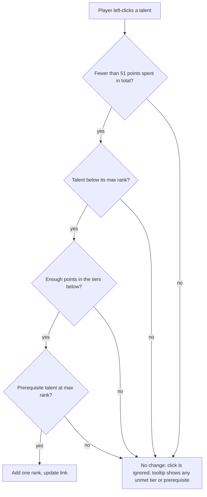

# PRD: WoW Forever Talent Calculator

Oct 17, 2026 · Kaloyan Manolov · [Live doc](https://claude.ai/code/artifact/98e43ff8-2c95-4765-af99-d88f099841db)

## Overview

A web talent calculator that lets World of Warcraft: Forever players plan and share a level-60 build for any of the 9 classes before and after the November 4, 2026 launch. It doubles as a showcase of AI-assisted development: v1 was researched, designed, built and verified by Claude in one session.

**Background.** WoW: Forever is Blizzard's third permanent game version, alongside Retail and Classic. It recreates the 2004 era with a level cap of 60, but every class has rebalanced talent trees, many new talents and a new 16-point milestone talent. Classic-era calculators therefore give wrong answers for Forever.

**Goals**

1. Give players an accurate, Forever-specific calculator for all 9 classes on launch day.
2. Make builds shareable as a single link.
3. Demonstrate end-to-end AI delivery: research, data gathering, implementation, tests and browser verification.

**Success metrics**

| Metric | Target |
| --- | --- |
| Classes covered at launch | 9 of 9 |
| Talent data matching the live game build | 100% of talents on launch day |
| Shared-link round trip | A shared link restores the exact build, every time |
| Time to first point allocated | Under 10 seconds from page load |

## Target users and user stories

The primary user is a WoW: Forever player choosing or refining a spec. Secondary users are guide writers and guild leaders who share builds, and stakeholders viewing the app as an AI demo.

| Persona | Need |
| --- | --- |
| New or returning player | Understand how a class's Forever trees differ from Classic before picking a class |
| Planner / min-maxer | Build a precise 51-point spec and check the level each talent arrives at |
| Guide writer / guild leader | Share a build with others as one link |
| Demo audience | See a polished, working product built by AI |

**User stories**

1. As a player, I pick a class and see its three Forever talent trees, so I can explore what is available.
2. As a player, I click a talent to add a point and right-click to remove one, so I can plan a build quickly.
3. As a player, I hover a talent to read what each rank does and what it requires, so I can make informed choices.
4. As a player, I see points spent, the tree split and the level required, so I know when my build is complete.
5. As a player, I can spot talents that are new in Forever, so I can learn what changed from Classic.
6. As a guide writer, I copy a link that restores my exact build, so I can share it in guides and chat.
7. As a player on a phone, I can use the calculator without horizontal scrolling.

## Scope

v1 is a single-page, client-only calculator for class talents; anything account-wide or server-backed is out of scope.

**In scope (v1)**

- All 9 classes: Druid, Hunter, Mage, Paladin, Priest, Rogue, Shaman, Warlock, Warrior, with 3 trees each
- Point allocation with tier and prerequisite rules, capped at 51 points
- Rich tooltips with per-rank descriptions and unmet requirements
- Build summary: points spent, tree split, required level
- Shareable build links and reset (per tree and whole build)
- Responsive layout for desktop, tablet and phone

**Out of scope (v1)**

- The Legacy System (account-wide talents such as Talented)
- Dual spec comparison, respec cost tracking
- Stats, gear or damage simulation
- User accounts, saved builds or a backend
- Races and racials
- Localisation (English only)
- A class-choice quiz (planned next, see Roadmap)

## Functional requirements

The calculator is one screen: header, class picker, build summary bar, three trees side by side, and a footer with help and data attribution.

| ID | Area | Requirement | Priority |
| --- | --- | --- | --- |
| FR-1 | Header | Show the product title and a countdown to launch ("launches in N days"); show "now live" after 4 Nov 2026, 15:00 PST. | Should |
| FR-2 | Class picker | List all 9 classes with icon and name in official class colour; the selected class is highlighted. | Must |
| FR-3 | Class picker | Switching class clears the current build. | Must |
| FR-4 | Trees | Show the class's three trees with name, icon and points spent per tree. | Must |
| FR-5 | Trees | Place each talent on a 4-column, 7-tier grid at its in-game position. | Must |
| FR-6 | Trees | Draw a connector from each prerequisite to the talent that requires it, highlighted once the prerequisite is maxed. | Must |
| FR-7 | Talent | Show the icon, current/max rank badge and a NEW badge when the talent is new in Forever. | Must |
| FR-8 | Talent | Visual states: locked (greyed), available (green), partially ranked (green glow), maxed (gold). | Must |
| FR-9 | Allocation | Left-click adds one rank when the rules allow; otherwise nothing happens. | Must |
| FR-10 | Allocation | Right-click or Shift+click removes one rank when the rules allow; the browser context menu is suppressed on talents. | Must |
| FR-11 | Tooltip | On hover or keyboard focus, show name, rank N/M, unmet tier or prerequisite requirements (in red), the current rank's text, the next rank's text, and a learn/unlearn hint. | Must |
| FR-12 | Summary | Show class name, points spent of 51, tree split (e.g. 31 / 20 / 0) and required level. | Must |
| FR-13 | Reset | Reset per tree and "Reset all"; disabled when there is nothing to reset. | Must |
| FR-14 | Sharing | The URL always reflects the current class and build; "Copy link" copies it and confirms with "Copied!". If the clipboard is unavailable, show the link in a prompt. | Must |
| FR-15 | Sharing | Opening a link restores the class and build; editing the URL hash in place updates the view. | Must |
| FR-16 | Footer | Show controls help, a link to the data source, a beta-data disclaimer and "Not affiliated with Blizzard Entertainment". | Must |

## Talent rules

A point can be added only when the build is under 51 points, the talent is below max rank, its tier is unlocked and its prerequisite is maxed; a point can be removed only if every other invested talent stays valid.

The checks run in order on every click; the first failed check stops it, and the tooltip lists any unmet tier or prerequisite requirement in red.

**Points and levels**

- One point per level from 10 to 60: 51 points in total.
- Points can be spread freely across all three trees.
- Required level for a build of P points (P > 0): **level = 9 + P**.

**Tiers**

- Each tree has 7 tiers. Tier T unlocks when at least (T − 1) × 5 points are spent on tiers below T in the same tree.
- Milestone talents sit at 11, 16, 21 and 31 points; they follow the normal tier rule, so they need no special handling.

**Prerequisites**

- A talent with a prerequisite unlocks only when that prerequisite is at max rank.
- A prerequisite is usually in a lower tier, but may sit in the same tier (Priest: Improved Mind Flay requires Mind Flay; Paladin: Divine Precision requires Holy Shock).

**Removing points**

- Removing a rank is allowed only if, after removal, every talent with points still meets its tier and prerequisite rules.
- Example: with 5 points in tier 1 and 1 in tier 2, no tier-1 point can be removed until the tier-2 point is removed first.

**Build link format**

- URL hash: `#/<class-id>/<tree1>-<tree2>-<tree3>`, e.g. `#/mage/0500320-0-31`.
- Each tree is one digit per talent, in tier then column order; trailing zeros and empty trailing trees are trimmed.
- When decoding, points are replayed tier by tier through the normal rules, so an invalid or tampered link drops illegal points instead of producing an impossible build.
- An unknown class id falls back to the first class.

## Data model and content

Talent data lives in one JSON file per class, loaded at build time; adding or updating a class needs no code change.

**Class**

| Field | Type | Notes |
| --- | --- | --- |
| id | string | Kebab-case, e.g. `mage`; used in links |
| name | string | Display name |
| color | hex string | Official class colour |
| icon | string, optional | Wowhead icon name, e.g. `classicon_mage` |
| source | URL | Where the data was taken from; shown in the footer |
| trees | 3 trees | In in-game order |

**Tree**: id, name, optional icon, and a list of talents.

**Talent**

| Field | Type | Notes |
| --- | --- | --- |
| id | string | Kebab-case of the name, unique within the class |
| name | string | Display name |
| tier | 1–7 | Row in the tree |
| column | 1–4 | Position in the row |
| maxRank | integer ≥ 1 | |
| requires | talent id, optional | Prerequisite that must be maxed; same tree, same or lower tier |
| ranks | list of strings | One description per rank, or a single entry for all ranks; may contain line breaks |
| icon | string, optional | Wowhead icon name |
| isNew | boolean, optional | True if the talent did not exist in Classic |

**Sources.** v1 data is from the Forever beta, game build 1.60.1.70425 (data generated 16 Oct 2026). Talent lists, tiers and prerequisites were cross-checked against the [warcraft.wiki.gg Forever pages](https://warcraft.wiki.gg/wiki/World_of_Warcraft:_Forever); columns, per-rank text and icons come from [Zockify's datamined talent data](https://www.zockify.com/forever/talents/). Where the two disagreed, the newer Zockify build data was used.

**Data quality rules (enforced by automated tests)**

- Every class has exactly 3 trees.
- Talent ids are unique within a tree, and no two talents share a tier and column.
- Tier is 1–7, column 1–4, maxRank ≥ 1, at least one rank description.
- Every prerequisite exists in the same tree at the same or a lower tier.

**Content counts (v1)**

| Class | Trees (talents per tree) |
| --- | --- |
| Druid | Balance 16, Feral Combat 20, Restoration 16 |
| Hunter | Beast Mastery 16, Marksmanship 16, Survival 18 |
| Mage | Arcane 19, Fire 17, Frost 19 |
| Paladin | Holy 17, Protection 16, Retribution 17 |
| Priest | Discipline 18, Holy 17, Shadow 17 |
| Rogue | Assassination 17, Combat 17, Subtlety 19 |
| Shaman | Elemental 16, Enhancement 18, Restoration 16 |
| Warlock | Affliction 17, Demonology 19, Destruction 16 |
| Warrior | Arms 17, Fury 17, Protection 18 |

## UX and visual design

The look follows the in-game talent frame: dark parchment panels, gold accents, Blizzard-style icons, and the selected class's colour as the page accent.

- **Theme:** dark only. Background near-black, panels dark brown, gold (#F8B700) for maxed talents and headings, green (#1EFF00) for learnable talents, red for unmet requirements.
- **Type:** Cinzel for titles, tree and class names; Inter for body text.
- **Icons:** game icons from the Wowhead CDN; when an icon fails to load, show the talent's initials on a dark tile.
- **Tooltips:** game-style dark-blue panels; open to the right of talents in columns 1–2 and to the left in columns 3–4 so they stay inside the tree.
- **Layout:** three trees side by side on desktop (each at least 290 px wide); they wrap to one column on narrow screens. No horizontal page scroll down to 375 px wide. Talent cells are 52 px (46 px under 400 px wide).

**Accessibility**

- Every talent is a real button, reachable by keyboard; focus shows the tooltip and a visible focus ring.
- Talents have an accessible name with the rank, e.g. "Arcane Focus, rank 2 of 5".
- Selected class uses `aria-pressed`; the class picker is a labelled navigation region.
- Gap: removing points needs a right-click or Shift+click, so there is no keyboard-only way to unlearn yet (see Open questions).

## Non-functional requirements

The app is a static single-page site with no backend, so it can be hosted on any static host or CDN.

| Area | Requirement |
| --- | --- |
| Stack | React 18, TypeScript 5.6, Vite 5; Vitest for tests; ESLint |
| Architecture | Calculator rules in one pure module (`src/lib/talents.ts`), separate from UI components and data files |
| Performance | Production bundle under 100 kB gzipped (v1: about 84 kB JS + 2 kB CSS); clicks update instantly |
| Browsers | Current Chrome, Edge, Firefox and Safari, desktop and mobile |
| Offline / network | Works without a backend; icons and fonts need internet access (Wowhead CDN, Google Fonts) |
| Privacy | No accounts, cookies, analytics or stored personal data; build state lives only in the URL |
| Quality gates | Type-check, lint, unit tests and production build all pass before release |
| Legal | Blizzard names and icons are used for fan purposes with a "Not affiliated with Blizzard Entertainment" notice |

## Acceptance criteria

v1 is accepted when every item below passes; all were verified for the 17 Oct 2026 build.

- [x] All 9 classes appear in the picker and each shows 3 trees with icons.
- [x] A tier-2 talent stays locked at 4 points in tier 1 and unlocks at the 5th point.
- [x] A talent with an unmaxed prerequisite cannot be learned; it can once the prerequisite is maxed.
- [x] A talent cannot go above its max rank.
- [x] The build stops at 51 points; the summary then shows 51 / 51 and required level 60.
- [x] Removing a point that would strand a higher-tier talent or break a prerequisite is blocked.
- [x] Right-click removes a point without opening the browser menu.
- [x] Tooltips show rank text, next-rank text and unmet requirements.
- [x] Copying a link and reloading it restores the same class and build.
- [x] A link with illegal points loads with those points dropped.
- [x] No horizontal scroll at 375 px wide; no console errors.
- [x] Data quality tests pass for all 9 class files.

## Risks, open questions and roadmap

The biggest risk is stale data: v1 uses beta data, and Blizzard may change talents before or after the 4 Nov 2026 launch.

**Risks**

| Risk | Impact | Mitigation |
| --- | --- | --- |
| Talent data changes at launch or in patches | Wrong builds and tooltips | Re-import data at launch and per patch; show the game build in the footer |
| `isNew` flags assigned by hand from memory of Classic | Some talents mislabelled as new or not new | Review flags against an authoritative Classic list |
| Third-party sources (wiki, Zockify, Wowhead CDN) change or block access | Data refresh or icons break | Keep data in the repo; initials fallback for icons; consider self-hosting icons |
| Use of Blizzard names and art | Takedown request | Fan-site notice; no monetisation; remove assets on request |

**Open questions**

- [ ] Is the total exactly 51 points? The Legacy perk "Talented" may give points at earlier levels; should v2 model it?
- [ ] Which talent in each tree is the 16-point milestone, and should it be highlighted?
- [ ] How should keyboard users remove points (e.g. Backspace or Delete on a focused talent)?
- [ ] Where will the app be hosted, and under what domain?
- [ ] Should the data source change from beta data to an official source once one exists?

**Roadmap**

1. **v1.1 — Launch data refresh:** re-import all 9 classes from the launch build; fix keyboard removal; show the data build number.
2. **v2 — Class quiz:** a short questionnaire (role, play style, solo vs group, faction) that recommends a class and opens the calculator with a suggested build.
3. **v2.x — Build library:** curated starter builds per spec (levelling, raiding, PvP) loadable in one click.
4. **Later:** races and racials with valid race and class combinations (including the new Skyborne race), Legacy System talents, dual-spec comparison, and localisation.

**Sources**

- [warcraft.wiki.gg — World of Warcraft: Forever](https://warcraft.wiki.gg/wiki/World_of_Warcraft:_Forever)
- [Zockify — WoW Forever talents](https://www.zockify.com/forever/talents/)
- [TechSpot — World of Warcraft: Forever launches November 4](https://www.techspot.com/news/113832-world-warcraft-forever-launches-november-4-new-race.html)
