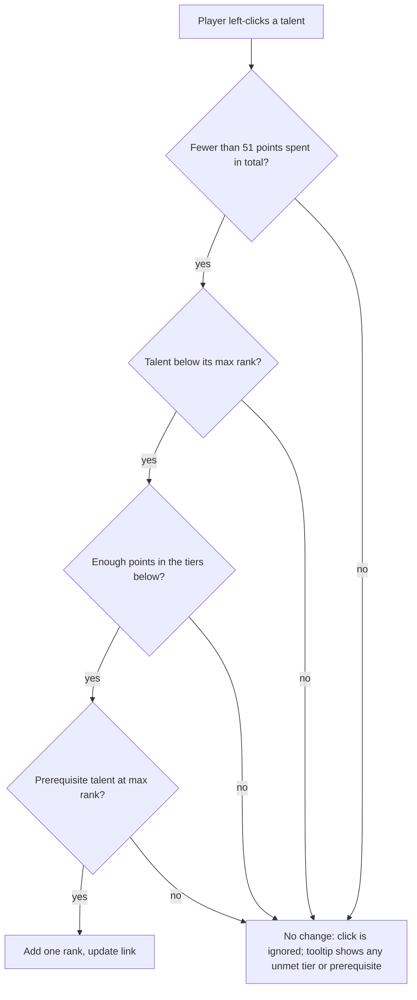

# PRD: WoW Forever Talent Calculator

Oct 17, 2026 · Kaloyan Manolov · [Live doc](https://claude.ai/code/artifact/98e43ff8-2c95-4765-af99-d88f099841db)

## Overview

A web talent calculator that lets World of Warcraft: Forever players plan and share a level-60 build for any of the 9 classes before and after the November 4, 2026 launch, with a Horde leveling guide that plans the road from level 1 to 60 a class guide (rotation, spells and talent leveling order), so far for the Warlock, and Horde profession guides, so far for Tailoring and Enchanting. It doubles as a showcase of AI-assisted development: v1 was researched, designed, built and verified by Claude in one session.

**Background.** WoW: Forever is Blizzard's third permanent game version, alongside Retail and Classic. It recreates the 2004 era with a level cap of 60, but every class has rebalanced talent trees, many new talents and a new 16-point milestone talent. Classic-era calculators therefore give wrong answers for Forever.

**Goals**

1. Give players an accurate, Forever-specific calculator for all 9 classes on launch day.
2. Make builds shareable as a single link.
3. Demonstrate end-to-end AI delivery: research, data gathering, implementation, tests and browser verification.

**Success metrics**

| Metric | Target |
| --- | --- |
| Classes covered at launch | 9 of 9 |
| Talent data matching the live game build | 100% of talents on launch day |
| Shared-link round trip | A shared link restores the exact build, every time |
| Time to first point allocated | Under 10 seconds from page load |

## Target users and user stories

The primary user is a WoW: Forever player choosing or refining a spec. Secondary users are guide writers and guild leaders who share builds, and stakeholders viewing the app as an AI demo.

| Persona | Need |
| --- | --- |
| New or returning player | Understand how a class's Forever trees differ from Classic before picking a class |
| Planner / min-maxer | Build a precise 51-point spec and check the level each talent arrives at |
| Guide writer / guild leader | Share a build with others as one link |
| Demo audience | See a polished, working product built by AI |

**User stories**

1. As a player, I pick a class and see its three Forever talent trees, so I can explore what is available.
2. As a player, I click a talent to add a point and right-click to remove one, so I can plan a build quickly.
3. As a player, I hover a talent to read what each rank does and what it requires, so I can make informed choices.
4. As a player, I see points spent, the tree split and the level required, so I know when my build is complete.
5. As a player, I can spot talents that are new in Forever, so I can learn what changed from Classic.
6. As a guide writer, I copy a link that restores my exact build, so I can share it in guides and chat.
7. As a player on a phone, I can use the calculator without horizontal scrolling.
8. As a new player, I answer a short quiz about how I like to play and get a recommended class and spec, so I know where to start.
9. As a Horde player who wants to see everything, I follow a leveling route that takes me through every Horde zone and dungeon close to its level, starting from my own race's starting zone, and tick off steps as I go.
10. As a player mid-way through leveling, I enter my level and jump to the step I should be doing now.
11. As a Warlock who wants to level fast, I follow one recommended leveling spec: the rotation for my current level, which talent to take at each level (and the build for my level in the calculator), which spell ranks are worth my gold at each trainer visit, and which items (quest rewards, dungeon drops, auction house buys) to go after as I level.
12. As a level 60 Warlock, I read each spec's dungeon and raid rotation.
13. As a Horde Tailor or Enchanter, I follow a route from skill 1 to 300: which trainer rank to learn where, what to make at each skill and how many, and which recipes are worth getting.
14. As a player mid-way through a profession, I enter my skill and see what to make now, the next trainer rank and the materials I still need.
15. As a Warlock leveling Tailoring or Enchanting, I see what the profession makes for me, at the level I can use it, and which patterns I have to buy or find first.
16. As a Tailor who also levels Enchanting, I follow a route that makes greens worth disenchanting and see what they break into.

## Scope

v1 is a single-page, client-only calculator for class talents; anything account-wide or server-backed is out of scope.

**In scope (v1)**

- All 9 classes: Druid, Hunter, Mage, Paladin, Priest, Rogue, Shaman, Warlock, Warrior, with 3 trees each
- Point allocation with tier and prerequisite rules, capped at 51 points
- Rich tooltips with per-rank descriptions and unmet requirements
- Build summary: points spent, tree split, required level
- Shareable build links and reset (per tree and whole build)
- Responsive layout for desktop, tablet and phone
- A class-choice quiz that recommends a class and spec from playstyle answers
- A Horde completionist leveling guide (1–60) with a level timeline, a route map and a step checklist
- A class guide with a leveling plan for one recommended spec (rotation by level range, talent order, trainer plan with training priorities, key gear upgrades), each spec's level 60 rotation and the trainer spells, for the Warlock only
- Horde profession guides for Tailoring and Enchanting: trainer ranks, a skill 1–300 route, the materials it needs and recipes worth getting, a class focus listing what each profession makes for that class (Warlock only so far) and a Tailoring route variant for players who also level Enchanting

**Out of scope (v1)**

- The Legacy System (account-wide talents such as Talented)
- Dual spec comparison, respec cost tracking
- Stats, gear or damage simulation
- User accounts, saved builds or a backend
- Races and racials
- Localisation (English only)
- Suggested starter builds from the quiz (see Roadmap: build library)
- An Alliance leveling guide, quest-by-quest directions, coordinates and real game maps
- Class guides for the other 8 classes (they show a "coming soon" note)
- Guides for the other professions, Alliance trainers and vendors, recipe costs in gold and auction-house prices

## Functional requirements

The app has four views, switched from the header: the calculator (class picker, build summary bar, three trees side by side, and a footer with help and data attribution), the class guide, the leveling guide and the profession guides. The class quiz opens as a modal dialog over any view.

| ID | Area | Requirement | Priority |
| --- | --- | --- | --- |
| FR-1 | Header | Show the product title and a countdown to launch ("launches in N days"); show "now live" after 4 Nov 2026, 15:00 PST. | Should |
| FR-2 | Class picker | List all 9 classes with icon and name in official class colour; the selected class is highlighted. | Must |
| FR-3 | Class picker | Switching class clears the current build. | Must |
| FR-4 | Trees | Show the class's three trees with name, icon and points spent per tree. | Must |
| FR-5 | Trees | Place each talent on a 4-column, 7-tier grid at its in-game position. | Must |
| FR-6 | Trees | Draw a connector from each prerequisite to the talent that requires it, highlighted once the prerequisite is maxed. | Must |
| FR-7 | Talent | Show the icon, current/max rank badge and a NEW badge when the talent is new in Forever. | Must |
| FR-8 | Talent | Visual states: locked (greyed), available (green), partially ranked (green glow), maxed (gold). | Must |
| FR-9 | Allocation | Left-click adds one rank when the rules allow; otherwise nothing happens. | Must |
| FR-10 | Allocation | Right-click or Shift+click removes one rank when the rules allow; the browser context menu is suppressed on talents. | Must |
| FR-11 | Tooltip | On hover or keyboard focus, show name, rank N/M, unmet tier or prerequisite requirements (in red), the current rank's text, the next rank's text, and a learn/unlearn hint. | Must |
| FR-12 | Summary | Show class name, points spent of 51, tree split (e.g. 31 / 20 / 0) and required level. | Must |
| FR-13 | Reset | Reset per tree and "Reset all"; disabled when there is nothing to reset. | Must |
| FR-14 | Sharing | The URL always reflects the current class and build; "Copy link" copies it and confirms with "Copied!". If the clipboard is unavailable, show the link in a prompt. | Must |
| FR-15 | Sharing | Opening a link restores the class and build; editing the URL hash in place updates the view. | Must |
| FR-16 | Footer | Show controls help, a link to the data source, a beta-data disclaimer and "Not affiliated with Blizzard Entertainment". | Must |
| FR-17 | Quiz | A "Find my class" button in the header opens the class quiz in a modal dialog; Esc or the close button closes it without changing the build. | Must |
| FR-18 | Quiz | Show one question at a time with "Question N of 8" progress; choosing an answer moves to the next question; "Back" returns to the previous one with the earlier answer marked. | Must |
| FR-19 | Quiz | After the last question, show the best match (class, spec, match %, a class tagline and the reasons from the answers) and the next two classes; "Retake quiz" starts over. Reopening the dialog shows the last results until the quiz is retaken or the page reloads. | Must |
| FR-20 | Quiz | "Open <Class> talents" closes the quiz, selects that class with an empty build, and marks the recommended tree "Suggested" until the class changes. | Must |
| FR-21 | Views | The header has "Talents", "Class guide", "Leveling guide" and "Professions" links; the current one is marked, and on phones the links wrap instead of scrolling the page. Switching views keeps the calculator's class and build, the class guide's class and spec, the starting zone and the profession. The subtitle names the current view. | Must |
| FR-22 | Guide | A starting-zone picker offers Durotar (Orc & Troll), Mulgore (Tauren), Tirisfal Glades (Undead) and Zephras Isle (Skyborne, Horde). The route starts there and never visits the other starting zones. | Must |
| FR-23 | Guide | The URL is `#/leveling/<starting-zone>`; opening it restores the guide and starting zone, and an unknown zone falls back to Durotar. | Must |
| FR-24 | Guide | A level timeline shows one row per zone or dungeon and one bar per visit along levels 1–60; zones and dungeons have different colours, unconfirmed level ranges are hatched, and hovering or focusing a bar shows the step, levels, quest hub and visit number. Clicking a bar selects that step. | Must |
| FR-25 | Guide | The route map is the in-game Forever map of one continent at a time (Kalimdor or Eastern Kingdoms). Each zone on the route is outlined on it and tinted by level band, with its name, level range and visit count (a label sits off the zone's centre where it would otherwise cover a neighbouring label or marker, so at the whole-continent view no label overlaps another label or marker); dungeons, cities and ports are marked and the route's legs drawn. Zones and dungeons are buttons: hovering or focusing one shows its levels, hubs and visits, and clicking selects it (a zone with several visits cycles through them). Clicking a zone centres the map on it and zooms in so its outline takes up about the middle 40% of the map, leaving the neighbouring zones in view (at most 2.5×); clicking a dungeon centres on its entrance and zooms in to at least 2.5×. The map opens zoomed in on the selected step, follows it to its continent and keeps it in view; it pans by dragging and zooms with buttons, double-click or Ctrl/⌘ + scroll. A caption says how to get to the selected step. | Must |
| FR-26 | Guide | The step list shows each step's number, name, zone or dungeon, visit number, quest hub and levels; the selected step expands to show how to get there, what to do and any unconfirmed details. Content new in Forever has a NEW badge. | Must |
| FR-27 | Guide | "My level" selects the first unfinished step covering that level. | Should |
| FR-28 | Guide | Each step has a "done" checkbox; the summary shows progress (done / total), which survives a reload; "Reset progress" clears it. | Should |
| FR-29 | Guide | A "Left out on purpose" panel lists the zones and dungeons the route skips and why. | Must |
| FR-30 | Guide | "Open <Zone> map" (in the selected step's detail and in the route map's toolbar) opens that zone's in-game Forever map in a modal dialog; a dungeon step opens its entrance zone. The map pins each quest hub with its name and the numbers of the route steps that use it; the shown trip's hubs are highlighted, and clicking a pin shows the next trip that uses that hub. Beside the map (below it on phones, where the map stays in view while the list scrolls) the dialog lists the route's trips to the zone: its visits and the dungeons entered from it, each with its step number, levels and hubs. The shown trip, at first the selected step or else the zone's first trip, is expanded with its directions, hubs (hubs in other zones marked apart), objectives and a "done" checkbox. Choosing a trip selects that step and keeps the dialog open. "Previous step" and "Next step" buttons walk the route and switch to the next step's zone map when it is elsewhere. The dialog also lists the zone's hubs with their coordinates and steps, and a note for zones Blizzard changed in Forever. Esc, the close button or a backdrop click closes it, and focus returns to the button that opened it. | Must |

| FR-31 | Class guide | The class guide shows the class picker and the selected class's guide. Its class is separate from the calculator's: it opens on the Warlock, and picking a class there neither changes the calculator's class nor clears its build. Its URL is `#/guide/<class-id>/<spec>`, where spec is a talent tree id; opening it restores the class and spec, a missing or unknown spec shows the recommended leveling spec, and a missing or unknown class shows the guide's current class (the Warlock at first). A class without a guide shows "<Class> guide coming soon" with links to the classes that have one. | Must |
| FR-32 | Class guide | "Leveling plan: <Spec>" names the class's one recommended leveling spec (the fastest to level) with a "Recommended" badge and why. A "My level" field (1–60) personalises the leveling plan and the spell list. | Must |
| FR-39 | Class guide | A navigation bar stays at the top of the screen while the guide scrolls. It holds the "My level" field and buttons for Rotation, Talents, Trainer, Gear, Specs at 60 and Spells; a button scrolls its section to just below the bar and moves focus to it, and the button of the section in view is marked current. On phones the buttons sit under the level field and scroll sideways, keeping the current one in view. | Must |
| FR-33 | Class guide | "Rotation by level" in the leveling plan has mode buttons ("Leveling", "Dungeons", "World PvP"; Leveling at first) and level-range buttons covering 1–60; the range for the entered level is shown (the first range when empty) until another is chosen, and the mode stays as chosen. Each range shows, for the chosen mode, its pet, a numbered priority list (icon, name, "talent" tag for talent abilities, "new in this range" for abilities not in the previous range's rotation for the same mode, a note) and tips; a range with no rotation for the mode (no dungeons before 13, no world PvP before 14) says why. With a level entered, abilities not available yet are dimmed and tagged with their level. | Must |
| FR-34 | Class guide | The leveling plan's "Talent order" lists the recommended spec's 51 points from level 10 to 60, grouped into runs of the same talent with levels, rank reached, tree and a note. With a level entered, finished runs are marked and the run in progress highlighted; the tree split for that level (60 when empty) is shown, and "Open level N build in the calculator" opens that build. | Must |
| FR-35 | Class guide | The leveling plan's "Trainer plan" lists each level at which new ranks unlock, with every rank marked "Must train" (worth buying even when gold is short), "Recommended" (when affordable) or "Skip" (no help while leveling), most important first; skipped ranks are hidden until "Show ranks to skip" is ticked. With a level entered, earlier visits fade, the next one is marked and a line names its must-train and recommended ranks. | Must |
| FR-38 | Class guide | The leveling plan's "Gear upgrades" lists the items that power the class up most while leveling, sorted by the level they can be used at: name in item-quality colour (linked to its Wowhead page, Forever where the item is in the Forever database, else Classic), slot, source (quest, dungeon, auction house, tailoring or class quest), where to get it (zone or dungeon with its level range, and the quest, boss or crafter), a stat summary, why it matters and a "Not confirmed" note where Forever data is missing. Source buttons filter the list. With a level entered, usable items are marked "Use now", items within 5 levels "Coming up" (also named in a status line), and items replaced by a later one for the same slot "Outgrown" and hidden unless "Hide outgrown items" is cleared. | Must |
| FR-36 | Class guide | "Specs at level 60" has a spec picker (the leveling spec marked "Leveling") showing the selected spec's summary, pet, strengths, weaknesses and its dungeon and raid priority list. Other specs also show their own talent order, noting that leveling them is slower. | Must |
| FR-40 | Professions | The profession guides have a profession picker (Tailoring, Enchanting; Tailoring at first) and no class picker. The URL is `#/professions/<profession-id>`; opening it restores the profession, and an unknown id shows Tailoring. The summary says the guide is for the Horde, and the class guide's navigation bar (FR-39) holds a "My skill" field (1–300) and buttons for Trainers, Route, Materials, Key recipes and Tips. Switching profession clears "My skill". | Must |
| FR-41 | Professions | "Trainers" lists the four ranks (Apprentice, Journeyman, Expert, Artisan) with the skill range, character level and the Horde trainers who teach each, with any cost or how to reach them. With a skill entered, ranks already learnable fade and the next one is marked. | Must |
| FR-42 | Professions | "Leveling route" lists the steps from skill 1 to 300: skill range, number of crafts, what to make (with icon), materials per craft, its learn skill and orange/yellow/green/grey thresholds where published, tools (enchanting rods), where a non-trainer recipe is learned, a NEW badge for recipes new or changed in Forever, a note, and "Not confirmed" for steps past the beta's skill cap of 225 or disputed materials. With a skill entered, finished steps fade, the current one is marked "Now" and a line says how many crafts of it are left (with its colour where known) and the next trainer rank; at 300 it says the route is finished. | Must |
| FR-43 | Professions | "Materials" totals what the route uses up, from the entered skill (the whole route when empty), most needed first, with where the Horde gets each; at the top it says nothing is left to buy. "Recipes worth getting" lists recipes valued for what they make (bags, caster gear, wands, camp recipes, Merchant's Favor recipes) with their learn skill, source, where, why and materials where known; with a skill entered, learnable ones are marked. "How <profession> works in Forever" explains the profession's Forever changes and its pairing with the other. | Must |
| FR-44 | Professions | "Focus on a class" offers None and the 9 classes; the class is kept in the URL (`#/professions/<profession-id>/<class-id>`) and when switching profession. With a class picked, "<Profession> for <Class>s" (and a "<Class> items" button in the navigation bar) lists what the profession makes for that class while leveling, sorted by the skill needed to make it, each with two badges at its side — the skill needed to make it and the level needed to use it ("Any" for enchants): name in item-quality colour linked to Wowhead's Forever page, slot, recipe source, "Soulbound" where only the crafter can use it, stats, "no pattern to buy" for trainer recipes or else the pattern's price and where it comes from, materials, why it matters and "Not confirmed" notes. With a skill entered, items that can be made are marked "Can make". Route steps whose result is on the list carry a tag with the class name. Classes without a list show "<Class> items coming soon"; only the Warlock has one. | Must |
| FR-45 | Professions | Tailoring has an "I also level Enchanting" checkbox. Ticked, steps with an Enchanting-paired alternative show it instead, marked "For enchanters", every green step says what disenchanting all its crafts gives, and the materials section adds the total disenchant yield; the material totals follow the swapped route. | Should |
| FR-37 | Class guide | "Spells" lists every trainer spell sorted by first level, with icon, school, description, rank levels coloured by training priority (with a breakdown when ranks differ and a reason), how it is learned when not from the trainer, a NEW badge for spells new or reworked in Forever and a "Not confirmed" note where Forever data is missing. School buttons filter the list. With a level entered, known ranks are underlined and unlearned spells dimmed. A few notes above the list explain class mechanics. | Must |

## Talent rules

A point can be added only when the build is under 51 points, the talent is below max rank, its tier is unlocked and its prerequisite is maxed; a point can be removed only if every other invested talent stays valid.

The checks run in order on every click; the first failed check stops it, and the tooltip lists any unmet tier or prerequisite requirement in red.

**Points and levels**

- One point per level from 10 to 60: 51 points in total.
- Points can be spread freely across all three trees.
- Required level for a build of P points (P > 0): **level = 9 + P**.

**Tiers**

- Each tree has 7 tiers. Tier T unlocks when at least (T − 1) × 5 points are spent on tiers below T in the same tree.
- Milestone talents sit at 11, 16, 21 and 31 points; they follow the normal tier rule, so they need no special handling.

**Prerequisites**

- A talent with a prerequisite unlocks only when that prerequisite is at max rank.
- A prerequisite is usually in a lower tier, but may sit in the same tier (Priest: Improved Mind Flay requires Mind Flay; Paladin: Divine Precision requires Holy Shock).

**Removing points**

- Removing a rank is allowed only if, after removal, every talent with points still meets its tier and prerequisite rules.
- Example: with 5 points in tier 1 and 1 in tier 2, no tier-1 point can be removed until the tier-2 point is removed first.

**Build link format**

- URL hash: `#/<class-id>/<tree1>-<tree2>-<tree3>`, e.g. `#/mage/0500320-0-31`.
- Each tree is one digit per talent, in tier then column order; trailing zeros and empty trailing trees are trimmed.
- When decoding, points are replayed tier by tier through the normal rules, so an invalid or tampered link drops illegal points instead of producing an impossible build.
- An unknown class id falls back to the first class.

## Class quiz

The quiz scores every spec against the answers and recommends the class whose best spec scores highest. It runs entirely in the browser and stores nothing.

**Tone.** The quiz is written for experienced WoW players. Each question is a joke scenario built on WoW and gamer stereotypes (pulling before the healer has mana, Tarren Mill on fire, "Can it tank?"), so the answer that leads to each trait is not obvious. Reasons on the result use the same voice, and the best match ends with a one-line class send-off.

**Questions (in order), by what they measure:** group role, class fantasy, main activity (solo, dungeons and raids, PvP), pet companion, rotation complexity, fight style (burst, damage over time, crowd control, support), survival style, and faction (where you hearth to).

**Scoring**

- Each spec has a profile of playstyle traits (e.g. `tank`, `holy`, `pet`, `burst`). Each answer gives weights to traits; a spec's score is the sum of the weights of its traits over all answers. Some weights are negative (e.g. "I'd rather fight alone" counts against pet specs).
- A class's score is its best spec's score; classes are ranked by that, ties in class-picker order.
- Match % = the spec's score ÷ the highest score the chosen answers could give, rounded and never below 0.
- Reasons are the answers that added points to the recommended spec.
- Faction: Alliance excludes Shaman and Horde excludes Paladin, as in Classic; "Not decided yet" excludes nothing.

Questions, spec profiles and class taglines live in `src/data/quiz.ts`; the scoring is a pure function in `src/lib/quiz.ts`. Automated tests check that every spec of every class has exactly one profile and that every class can be the top recommendation for some set of answers.

## Leveling guide

The guide plans a Horde completionist playthrough: every Horde quest hub and every dungeon the Horde can reasonably reach, each done as close to its level as the route allows. Wide-ranging zones are visited several times (the Barrens and Stranglethorn Vale three times each).

**Route rules (enforced by automated tests)**

- The route is the chosen starting zone, then one shared route of 73 steps from level 10 to 60, ordered by the level each step starts at, with no level left uncovered.
- Every non-starting Horde zone and every listed dungeon appears at least once; no step goes to a starting zone.
- A step starts no more than 2 levels below its place's level range and ends within it.
- Every zone with Horde quests has an outline on the map, and every dungeon entrance lies inside its zone or on an island just off its coast. A completionist outlevels content, so arriving a little early is preferred to arriving late.
- Repeat visits to a place come at increasing levels and do not overlap.
- Travel between steps is computed: crossing continents uses the zeppelin (Orgrimmar–Undercity, Orgrimmar–Grom'gol) arriving nearest the destination; the boats (Ratchet–Booty Bay, Steamwheedle Port–Powderfuse Port) only when both places are near their docks; and the Undercity–Grom'gol zeppelin within the Eastern Kingdoms only when one end is in Tirisfal or Stranglethorn. Horde Skyborne leave Zephras Isle by airship to Skywatcher Plateau in Mulgore.

**What is left out**

- Other Horde starting zones, Alliance starting zones, and zones with no Horde quests (Westfall, Redridge, Duskwood, Loch Modan, Wetlands, Darkshore, Deadwind Pass, Moonglade).
- Dungeons deep in Alliance territory: The Deadmines, The Stockade, Gnomeregan, and the new Hall of Thanes (inside Old Ironforge). The new Excavation Site in the Wetlands is on the route: it has Horde quests (from Hammerfall, Orgrimmar and Thunder Bluff) and the Horde reach it over the hills from Arathi Highlands.
- Raids and battlegrounds.

**Forever content.** The route includes the new zones Riverglades (35–45; Horde hub Rog'mar, with flights to Stonard, Kargath, Flame Crest and Hammerfall, and a ship from Powderfuse Port to Tanaris), Shen'dralas (range unannounced; entered from southern Desolace through the Valley of Bones; placed at 44–47) and Mount Hyjal (endgame, through Darkwhisper Gorge in Winterspring), the Skyborne starting zone Zephras Isle (1–12), and the new dungeons Ruins of Lordaeron, Excavation Site: Wetlands, City of Dalaran, The Drowned City, Krol'dok Stronghold, Alcaz Prison, Blackmaw Hold and Shaper's Terrace. Dungeon brackets are Blizzard's beta brackets where published; hubs, flight paths and ships come from beta client data. Anything not confirmed by Blizzard shows a "Not confirmed" note. Other zones use their Forever ranges where sources publish them (Travelcraft, Wowhead) and their 2004 Horde quest hubs.

**Zone maps and hubs.** Each zone's in-game Forever map is in `public/maps/zones/<zone-id>.webp` (from warcraft.wiki.gg). Hub positions in `src/data/hubs.ts` are in-game coordinates (0–100), taken from each hub's flight master, innkeeper or main questgiver in the vanilla 1.12 database at classicdb.ch, and checked against the Forever map images. Hubs in new zones (Rog'mar, Powderfuse Port and Hyjal's flight points) are placed at their labels on the Forever zone maps. Tests check that every zone has a map and a hub list, that every hub a zone or zone step names exists, and that every pin is on its map.

**Map.** The map images are the in-game Forever continent maps (1002×668 px), kept in `public/maps/`. Zone outlines in `src/data/mapShapes.ts` were traced from the zone borders on those images; where the map's own lettering hides a border (Stonetalon and Desolace, Searing Gorge, Burning Steppes, Badlands and Riverglades) the border is approximate.

**Data.** Zones, dungeons, the route, map positions and exclusions live in `src/data/leveling.ts`, zone outlines in `src/data/mapShapes.ts`; route building, travel directions and level lookups are pure functions in `src/lib/leveling.ts`. The guide loads as a separate chunk, so the calculator's first load does not grow.

## Class guide

The class guide covers the Warlock; other classes show a "coming soon" note until their guides are written.

**Rules (enforced by automated tests)**

- The leveling spec is one of the class's specs. Its rotations cover levels 1 to 60 in consecutive ranges, each with a solo leveling rotation; dungeon and world PvP rotations start at some range and continue to 60, and a range without one has a note saying why. Every rotation uses only spells learned and talents taken by the end of its range and never a spell rank marked "Skip", and every spell a solo leveling range relies on from its start is "Must train".
- Gear upgrades have unique ids and levels 1–60; every place named is a zone or dungeon of the leveling guide, every dungeon drop names its dungeon, and no dungeon drop needs a level more than 2 above the dungeon's range.
- Every spec of a class with a guide has exactly one spec guide, whose talent order spends exactly 51 points, one per level from 10 to 60, each legal under the calculator's talent rules, with at least 31 points (and the most) in the spec's own tree.
- Rotations name only spells from the guide or talents the spec's order takes.
- Spell ids are unique, each spell's rank levels rise between 1 and 60, and per-rank training priorities name real rank levels.

**Warlock content.** Forever renames Curse of Agony and Curse of Doom to Bane of Agony and Bane of Doom (one Bane plus one curse per warlock on a target), removes Curse of Shadow, makes Curse of the Elements cover every magic school from level 20, renames Enslave Demon to Subjugate Demon, turns Firestone and Spellstone into weapon imbues and makes Life Tap scale with Spirit. First levels up to 42 come from the beta trainer (the beta stopped at level 30 to 40); later ranks and the level 48+ spells (Soul Fire, Inferno, Bane of Doom, Ritual of Doom, the mounts) follow Classic 1.12 and are marked "Not confirmed" where they matter. Affliction is the recommended leveling spec, as in every published Forever leveling guide: instant DoTs and drains with a Voidwalker tank mean almost no downtime. No source publishes a full 1–60 talent order, rotation by level or training priorities, so these are the guide's own, built from the published leveling advice (Warcraft Tavern, Method) and checked against the talent rules. Gear upgrades use Wowhead's datamined Forever item stats where the item is in the beta database (Forever re-itemised many leveling items, mostly adding Shadow or spell damage, so Robe of Doan now gives Fire damage and is left out); items without Forever data show Classic 1.12 stats with a "Not confirmed" note. Dungeon rotations swap the Voidwalker for the Imp (it stays at range, costs no Soul Shard to resummon and buffs the party's Stamina), suggest the Succubus or Incubus from 20 when the group needs crowd control on humanoids, and lean on the healer instead of Drain Life early on; Immolate stays in them for bosses until about 20, which is why its level 10 rank is "Recommended". World PvP rotations open with instant DoTs from range, then Fear and Drain Life, with Death Coil and Howl of Terror from the forties. Training priorities assume Affliction leveling: for example, Drain Soul rank 1 collects shards as well as any rank, so later ranks are "Skip".

**Data.** Guides live in `src/data/classGuides/<class>.ts` (types in `src/data/classGuides/types.ts`); talent-order expansion, the build at a level and trainer lookups are pure functions in `src/lib/classGuide.ts`. The guide loads as a separate chunk.

## Profession guides

The profession guides cover Tailoring and Enchanting for the Horde; they pair well (Tailoring makes the greens Enchanting disenchants, and neither needs a gathering profession). Both routes are computed from Wowhead's datamined Forever recipe data: at each skill they take the trainer recipe (or Horde-reachable vendor pattern) with the lowest expected cost per skill point among those with at least a 50% chance of a point; the chance is 100% while orange, then (grey − skill) / (grey − yellow). Where a recipe's orange skill is 0 in the data, its learn skill is the one the data gives. For Tailoring, cost is cloth and bolts at what a vendor pays for them, thread and dye at vendor prices, less what a vendor pays for the result; steps shorter than 4 points are merged into a neighbour. For Enchanting, every material sells to vendors for 1 copper, so each is valued at what getting it gives up: the price of a green or blue you would otherwise sell, divided by how many of the material disenchanting it gives (Classic's disenchant table), from the cheapest source (green armor for dust, green weapons for essences, blues for shards) and never above a vendor's price. Item prices are the median Forever vendor price of greens and blues per item-level band. They live with the yields and an override list in `docs/research/professions/enchanting-material-values.json`: replace them with auction prices of greens, or override single materials with their own auction prices, and rerun `node scripts/professions/cheapest-route.mjs enchanting` (its header lists the flags) to see whether the route changes. At these prices Strange Dust is worth about 1s 23c, Lesser Magic Essence 3s 90c, Soul Dust 8s, Vision Dust 18s, Dream Dust 35s and Greater Nether Essence 1g 68s. Wood, rods and Motes cost their vendor price, less what a vendor pays for the result (wands). The runed rods are added by hand when learnable (100, 150, 200, 299), and new Forever formulas with no known source are left out. Enchanting recipes whose Forever colours are incomplete (zeros, or grey equal to the learn skill) would fall back to Classic's thresholds and be marked "Not confirmed"; every recipe the Enchanting guide lists has complete Forever colours. Both name only Horde trainers (plus neutral Booty Bay, Uldaman and Zephras Isle) and vendors the Horde can reach (Stonetalon, Undercity, Everlook, Moonglade).

**Rules (enforced by automated tests)**

- Each route runs from skill 1 to 300 in consecutive steps, each with at least one craft per skill point and a recipe that has materials.
- Where a recipe's learn skill or colour thresholds are published, every step using it starts at or above its learn skill and below its grey skill, and plans at least as many crafts as its colours predict.
- No step needs a trainer rank before the rank's skill: the rank whose cap covers a step's end is learnable at the step's start.
- Trainer ranks rise in skill, level and cap, each learnable before the previous cap, up to 300.
- Every step from 225 on is marked "Not confirmed" (the beta stopped at 225, so these follow Classic), and no step below 225 is.
- Recipe and material ids are unique; recipes name only known materials; key recipes exist.

**Forever content.** Tailoring has about 180 new recipes: caster sets in six spell-school variants (Merchant's Favor from Durotar Supply and Logistics, and Filigreed patterns from bosses in Ragefire Chasm, Shadowfang Keep, Blackfathom Deeps, Razorfen Kraul and Scarlet Monastery), a reagent-bag line from 6 to 20 slots, bigger bags (Red Linen Bag has 8 slots) and the camp recipes Faction Banner, Spinning Wheel and Loom. Enchanting has about 60: spell-power wands from level 5 (and Novice's Practice Wand at skill 10), Mote of Magic (3 from 1 Strange Dust, 10 copper from vendors), bracer, weapon (140), necklace (210) and off-hand (300) enchants, and the camp recipes Enchanted Lute, Arcane Salvager and Arcane Forge. Skill 150, 225 and 300 each give a Legacy point. Forever's datamined thresholds are 10–40 points lower than Classic's (most recipes turn yellow as soon as they are learned), and above skill 125 most Tailoring ones are not datamined yet (Enchanting's are, up to 300); Tailoring recipes without Forever thresholds use Classic's and are marked "Not confirmed". At vendor prices the Tailoring route costs about 36 gold: bolts and Linen Bags (2 silver each in Forever) earn money, and Linen Bags replace Heavy Linen Gloves at 45–55. The materials list counts bolts and rods the route makes itself only for the shortfall, as cloth.

**Pairing with Enchanting.** Vendors pay 1 copper for every Enchanting material in Forever, so disenchanting a green always gives up its vendor price; it pays only for materials an Enchanter would otherwise buy. Disenchant yields use Classic's table by item level (Forever's observed results for Woolen Cape match it). An alternative step is offered where its greens give Enchanting materials at about 50 copper of lost vendor value per Strange Dust or less: Brown Linen Pants instead of Linen Belts at 56–70, and Woolen Capes instead of Woolen Boots at 98–110 (more dust for less once neither is sold). Disenchanted, the paired route gives about 235 Strange Dust, 47 Soul Dust, 144 Vision Dust and 131 Dream Dust but few Lesser Magic Essences.

**Enchanting route.** Nothing but the Runed Copper Rod is learnable below skill 10, so the route opens with about 16 rods (the last two points below a 50% chance). Five Lesser Magic Wands take it to 15; from there it runs on Strange Dust: Enchant Chest – Inferior Stamina (learned at 15, orange to 70) to 90, Enchant Cloak – Minor Protection (2 dust) to 128, Enchant 2H Weapon – Minor Impact (dust and a Small Glimmering Shard) to 136 and Enchant Boots – Minor Stamina (4 dust, still cheaper than one Soul Dust) to 166: about 317 Strange Dust and 9 Lesser Magic Essences in all, where Zockify's wand route used about 140 essences. Boots – Lesser Agility (Soul Dust) follows to 200, Vision Dust enchants to 260, Enchant 2H Weapon – Greater Impact (Large Radiant Shard and Dream Dust) to 277 and Enchant Shield – Greater Stamina (Dream Dust, from Daniel Bartlett in Undercity) to 299, about 108 gold of materials at these values. Disenchant also gives skill-ups (Forever's data: yellow 20, green 40, grey 60, the same as Classic's); the route does not count them, because how many greens a player breaks varies, and says so at 15–75 and in the tips, where entering "My skill" rescales what is left. Enchant Bracer – Inferior Stamina, which Zockify's route used from skill 2, is learned at 20 in Forever and gives points only to 25, so it is not on the route.

**Class focus (Warlock).** Tailoring lists Forever's Shadow line (Shadow Boots, Gloves, Sash, Circlet, Gown and Leggings, skill 60–125, 30 Merchant's Favor each from Jim'bek in the Barrens), the Black and Netherpearl lines (skill 140–235, 60–90 Merchant's Favor, Black Slippers from the trainer), the Filigreed Shadow dungeon patterns, trainer spell-power pieces, Felcloth pieces and the Robe of the Void. They need Forever's Alchemy dyes (Cerulean, Magenta, Viridian), Shadowgems and Black Pearls. Enchanting lists the wand line (every crafted wand carries spell power in Forever; the four new mid-level wands have formulas whose source is not datamined yet) and the Stamina and Intellect enchants, plus the new necklace and off-hand enchants from Beneris in the Barrens. Data comes from Wowhead's Forever item, recipe and vendor data. Where sources disagree on which trainer teaches which Tailoring rank, the guide follows Zockify.

**Data.** Guides live in `src/data/professions/<profession>.ts` (types in `src/data/professions/types.ts`, ids in `src/data/professions/ids.ts`); recipe colours, the step at a skill, crafts left, material totals and the next trainer rank are pure functions in `src/lib/professions.ts`. The guides load as a separate chunk.

## Data model and content

Talent data lives in one JSON file per class, loaded at build time; adding or updating a class needs no code change.

**Class**

| Field | Type | Notes |
| --- | --- | --- |
| id | string | Kebab-case, e.g. `mage`; used in links |
| name | string | Display name |
| color | hex string | Official class colour |
| icon | string, optional | Wowhead icon name, e.g. `classicon_mage` |
| source | URL | Where the data was taken from; shown in the footer |
| trees | 3 trees | In in-game order |

**Tree**: id, name, optional icon, and a list of talents.

**Talent**

| Field | Type | Notes |
| --- | --- | --- |
| id | string | Kebab-case of the name, unique within the class |
| name | string | Display name |
| tier | 1–7 | Row in the tree |
| column | 1–4 | Position in the row |
| maxRank | integer ≥ 1 | |
| requires | talent id, optional | Prerequisite that must be maxed; same tree, same or lower tier |
| ranks | list of strings | One description per rank, or a single entry for all ranks; may contain line breaks |
| icon | string, optional | Wowhead icon name |
| isNew | boolean, optional | True if the talent did not exist in Classic |

**Sources.** v1 data is from the Forever beta, game build 1.60.1.70425 (data generated 16 Oct 2026). Talent lists, tiers and prerequisites were cross-checked against the [warcraft.wiki.gg Forever pages](https://warcraft.wiki.gg/wiki/World_of_Warcraft:_Forever); columns, per-rank text and icons come from [Zockify's datamined talent data](https://www.zockify.com/forever/talents/). Where the two disagreed, the newer Zockify build data was used.

**Data quality rules (enforced by automated tests)**

- Every class has exactly 3 trees.
- Talent ids are unique within a tree, and no two talents share a tier and column.
- Tier is 1–7, column 1–4, maxRank ≥ 1, at least one rank description.
- Every prerequisite exists in the same tree at the same or a lower tier.

**Content counts (v1)**

| Class | Trees (talents per tree) |
| --- | --- |
| Druid | Balance 16, Feral Combat 20, Restoration 16 |
| Hunter | Beast Mastery 16, Marksmanship 16, Survival 18 |
| Mage | Arcane 19, Fire 17, Frost 19 |
| Paladin | Holy 17, Protection 16, Retribution 17 |
| Priest | Discipline 18, Holy 17, Shadow 17 |
| Rogue | Assassination 17, Combat 17, Subtlety 19 |
| Shaman | Elemental 16, Enhancement 18, Restoration 16 |
| Warlock | Affliction 17, Demonology 19, Destruction 16 |
| Warrior | Arms 17, Fury 17, Protection 18 |

## UX and visual design

The look follows the in-game talent frame: dark parchment panels, gold accents, Blizzard-style icons, and the selected class's colour as the page accent.

- **Theme:** dark only. Background near-black, panels dark brown, gold (#F8B700) for maxed talents and headings, green (#1EFF00) for learnable talents, red for unmet requirements.
- **Type:** Cinzel for titles, tree and class names; Inter for body text.
- **Icons:** game icons from the Wowhead CDN; when an icon fails to load, show the talent's initials on a dark tile.
- **Leveling guide charts:** zone visits in blue and dungeons in orange on the timeline; on the map, route zones are tinted by level band in five hues running cool to hot (teal 1–19, blue 20–29, violet 30–39, magenta 40–49, red 50–60), chosen to stay distinguishable over the parchment map with colour-blind vision, and separated by thin dark borders; zone outlines do not overlap. Labels, level ranges and a legend mean colour is never the only cue; the selected zone is outlined in gold and other starting zones are shaded out.
- **Tooltips:** game-style dark-blue panels; open to the right of talents in columns 1–2 and to the left in columns 3–4 so they stay inside the tree.
- **Layout:** three trees side by side on desktop (each at least 290 px wide); they wrap to one column on narrow screens. No horizontal page scroll down to 375 px wide. Talent cells are 52 px (46 px under 400 px wide).

**Accessibility**

- Every talent is a real button, reachable by keyboard; focus shows the tooltip and a visible focus ring.
- Talents have an accessible name with the rank, e.g. "Arcane Focus, rank 2 of 5".
- Selected class uses `aria-pressed`; the class picker is a labelled navigation region.
- Gap: removing points needs a right-click or Shift+click, so there is no keyboard-only way to unlearn yet (see Open questions).

## Non-functional requirements

The app is a static single-page site with no backend, so it can be hosted on any static host or CDN.

| Area | Requirement |
| --- | --- |
| Stack | React 18, TypeScript 5.6, Vite 5; Vitest for tests; ESLint |
| Architecture | Calculator rules in one pure module (`src/lib/talents.ts`), separate from UI components and data files |
| Performance | Initial load under 100 kB gzipped (about 90 kB JS + 6 kB CSS); the leveling guide (about 22 kB), class guide (about 16 kB) and profession guides (about 20 kB) load on demand; clicks update instantly |
| Browsers | Current Chrome, Edge, Firefox and Safari, desktop and mobile |
| Offline / network | Works without a backend; icons and fonts need internet access (Wowhead CDN, Google Fonts); the map images (two continent maps of about 190 kB each, and 34 zone maps of 130–190 kB each, loaded only when opened) are served with the app |
| Privacy | No accounts, cookies, analytics or stored personal data; build state lives only in the URL. Leveling-guide progress (ticked step ids) is kept in the browser's local storage and never leaves the device |
| Quality gates | Type-check, lint, unit tests and production build all pass before release |
| Legal | Blizzard names, icons and map images are used for fan purposes with a "Not affiliated with Blizzard Entertainment" notice; the map credits Blizzard and warcraft.wiki.gg |

## Acceptance criteria

v1 is accepted when every item below passes; all were verified for the 17 Oct 2026 build.

- [x] All 9 classes appear in the picker and each shows 3 trees with icons.
- [x] A tier-2 talent stays locked at 4 points in tier 1 and unlocks at the 5th point.
- [x] A talent with an unmaxed prerequisite cannot be learned; it can once the prerequisite is maxed.
- [x] A talent cannot go above its max rank.
- [x] The build stops at 51 points; the summary then shows 51 / 51 and required level 60.
- [x] Removing a point that would strand a higher-tier talent or break a prerequisite is blocked.
- [x] Right-click removes a point without opening the browser menu.
- [x] Tooltips show rank text, next-rank text and unmet requirements.
- [x] Copying a link and reloading it restores the same class and build.
- [x] A link with illegal points loads with those points dropped.
- [x] No horizontal scroll at 375 px wide; no console errors.
- [x] Data quality tests pass for all 9 class files.
- [x] The class quiz recommends a class and spec after 8 questions, lists two runners-up, and "Open … talents" loads that class with the suggested tree marked.
- [x] The quiz respects the faction answer (no Paladin for Horde, no Shaman for Alliance) and has no horizontal scroll at 375 px.
- [x] The leveling guide starts in the chosen starting zone, never visits the other starting zones, and skips The Deadmines, The Stockade and Gnomeregan.
- [x] The guide's timeline shows three Barrens visits; clicking a bar or a map zone selects that step, and the map follows the step's continent.
- [x] "My level" selects a step covering that level; ticked steps survive a reload and "Reset progress" clears them.
- [x] Route rule tests pass (coverage of 10–60, every zone and dungeon visited, steps close to their level range); the guide has no horizontal scroll at 375 px.
- [x] The route map shows the in-game continent map with clickable zone outlines; it zooms, pans and returns to the whole continent.
- [x] A step's zone map opens from the step or the route map, pins the zone's quest hubs with the step's hub highlighted, and fits a 375 px screen.
- [x] The leveling plan's rotation switches between leveling, dungeon and world PvP modes for every level range, explaining ranges without dungeons or PvP.
- [x] The class guide opens on the Warlock without changing the calculator's class or build, and its navigation bar jumps to every section.
- [x] The profession guides open on Tailoring from the header, switch to Enchanting and restore either from the URL; each has Horde trainers for all four ranks and a 1–300 route marking steps past 225 "Not confirmed"; "My skill" marks the current step, the next trainer rank and the materials left; no horizontal scroll at 375 px (verified 18 Oct 2026).
- [x] The profession guides focus on the Warlock: each lists the Warlock's items by level with pattern prices and sources, other classes say "coming soon", and Tailoring's "I also level Enchanting" swaps in disenchant-friendly steps (verified 18 Oct 2026).
- [x] The Warlock class guide recommends one leveling spec (Affliction) with a rotation for every level range, a legal 51-point talent order and a trainer plan marking each rank "Must train", "Recommended" or "Skip", and key gear upgrades by level and source; "My level" picks the rotation, marks the next trainer visit, dims what is not learned yet and opens the build for that level in the calculator; each spec shows its level 60 rotation; other classes show "coming soon"; no horizontal scroll at 375 px.

## Risks, open questions and roadmap

The biggest risk is stale data: v1 uses beta data, and Blizzard may change talents before or after the 4 Nov 2026 launch.

**Risks**

| Risk | Impact | Mitigation |
| --- | --- | --- |
| Talent data changes at launch or in patches | Wrong builds and tooltips | Re-import data at launch and per patch; show the game build in the footer |
| `isNew` flags assigned by hand from memory of Classic | Some talents mislabelled as new or not new | Review flags against an authoritative Classic list |
| Third-party sources (wiki, Zockify, Wowhead CDN) change or block access | Data refresh or icons break | Keep data in the repo; initials fallback for icons; consider self-hosting icons |
| Use of Blizzard names and art | Takedown request | Fan-site notice; no monetisation; remove assets on request |
| Forever's new zones and dungeons are only known from pre-launch coverage and beta data | Leveling steps at the wrong level, or missing Horde hubs | Mark unconfirmed content in the guide; re-check levels and hubs at launch |
| Map images or zone borders change at launch | Outlines no longer match the map | Re-trace `mapShapes.ts` from the launch map; tests check every zone has an outline and every entrance sits in its zone |
| Blizzard revamps classic zones ("expanded and overhauled") without saying which | Classic quest hubs or levels in the guide may be out of date | Review each zone against the live game at launch |

**Open questions**

- [ ] Is the total exactly 51 points? The Legacy perk "Talented" may give points at earlier levels; should v2 model it?
- [ ] Which talent in each tree is the 16-point milestone, and should it be highlighted?
- [ ] How should keyboard users remove points (e.g. Backspace or Delete on a focused talent)?
- [ ] Where will the app be hosted, and under what domain?
- [ ] Should the data source change from beta data to an official source once one exists?
- [ ] Are Paladin and Shaman still faction-locked in Forever? The quiz assumes the Classic rule.
- [ ] Should quiz results be shareable as a link?
- [ ] Does the Steamwheedle Port–Powderfuse Port ship sail at launch, and does Powderfuse Port get a Horde flight path?
- [ ] What level range and Horde hubs does Shen'dralas have, and which new dungeons have Horde quests?
- [ ] Does the Horde still need the Dalaran Sewer Key for City of Dalaran after the Oct 15 change?
- [ ] Should there be an Alliance leveling guide?
- [ ] What do Tailoring and Enchanting look like above skill 225 at launch, and what are the Forever learn skills and colour thresholds of the route's recipes?
- [ ] Which Horde vendors sell the Merchant's Favor recipes, and at what prices?
- [ ] What are the Forever trainer levels above 42 (Soul Fire, Inferno, Bane of Doom, Ritual of Doom) and the later spell ranks?

**Roadmap**

1. **v1.1 — Launch data refresh:** re-import all 9 classes from the launch build; fix keyboard removal; show the data build number.
2. **v2 — Class quiz (shipped):** an 8-question questionnaire that recommends a class and spec and opens the calculator on it with the suggested tree marked.
3. **v2.x — Build library:** curated starter builds per spec (levelling, raiding, PvP) loadable in one click; the quiz will then open its recommendation with a starter build.
4. **v3 — Horde leveling guide (shipped):** a completionist 1–60 route with a level timeline, route map, step checklist and level lookup.
5. **v3.1 — Class guide (Warlock shipped):** a leveling plan for the recommended spec (rotation by level, talent order, trainer plan), level 60 rotations per spec and the spell list; the other 8 classes to follow. Training gold costs once Forever trainer prices are known.
6. **v3.2 — Profession guides (Tailoring and Enchanting shipped):** Horde trainer ranks, a skill 1–300 route, materials and key recipes; other professions, gold costs and an Alliance version to follow.
7. **Later:** races and racials with valid race and class combinations (including the new Skyborne race), Legacy System talents, dual-spec comparison, and localisation.

**Sources**

- [warcraft.wiki.gg — World of Warcraft: Forever](https://warcraft.wiki.gg/wiki/World_of_Warcraft:_Forever)
- [Zockify — WoW Forever talents](https://www.zockify.com/forever/talents/)
- [TechSpot — World of Warcraft: Forever launches November 4](https://www.techspot.com/news/113832-world-warcraft-forever-launches-november-4-new-race.html)
- [Warcraft Tavern — All new zones and areas in WoW: Forever](https://www.warcrafttavern.com/forever/news/all-new-zones-areas-in-wow-forever-revealed-at-blizzcon/)
- [Gfinity — Skyborne race and Zephras Isle guide](https://www.gfinityesports.com/article/world-of-warcraft-forever-skyborne-race-zephras-isle-guide)
- [AccountShark — WoW Forever preview: zones, dungeons and races](https://accountshark.net/blog/wow-forever-complete-preview-2026-zones-dungeons-races) (new dungeon level ranges, citing Wowhead)
- [Travelcraft — WoW Forever guide: zones and levels](https://wow-travelcraft.com/guide.html) (zone ranges, flight paths, ships)
- [WoW Forever Guides — leveling](https://wowforeverguides.com/leveling) (beta client data: Rog'mar, Excavation Site and Ruins of Lordaeron quests, Blizzard dungeon brackets)
- [ConquestCapped — WoW Forever new zones](https://conquestcapped.com/guides/wow-forever/wow-forever-new-zones/) and [LFCarry — WoW Forever new zones](https://lfcarry.com/guides/wow-forever-new-zones) (Riverglades, Shen'dralas, Hyjal access, Dalaran change)
- [warcraft.wiki.gg — Forever map comparison](https://warcraft.wiki.gg/wiki/Forever_map_comparison) (continent and zone map images)
- [classicdb.ch](https://classicdb.ch/) (vanilla 1.12 NPC coordinates for quest hub positions)
- [Zockify — WoW Forever warlock](https://www.zockify.com/forever/warlock/), [Warcraft Tavern — warlock leveling guide](https://www.warcrafttavern.com/forever/guides/warlock-leveling/) and [class guide](https://www.warcrafttavern.com/forever/guides/warlock/), [Method — warlock leveling guide](https://www.method.gg/wow-forever/wow-forever-warlock-leveling-guide-and-talents) (warlock spells, Banes, pets and leveling advice)
- [Zockify — WoW Forever professions](https://www.zockify.com/forever/professions/) (profession trainers), [Kami-labs — WoW Forever tailoring guide](https://kami-labs.fr/en/guide-couture-wow-forever/), [SeeMeta — WoW Forever professions](https://seemeta.com/en/wow-forever/professions) (recipe colours), Wowhead's Forever [Tailoring](https://www.wowhead.com/forever/spells/professions/tailoring) and [Enchanting](https://www.wowhead.com/forever/spells/professions/enchanting) recipes (datamined recipes, thresholds and vendor prices), and Warcraft Tavern's [Tailoring](https://www.warcrafttavern.com/forever/guides/tailoring/) and [Enchanting](https://www.warcrafttavern.com/forever/guides/enchanting/) overviews (Forever changes)
- [Wowhead — WoW Forever items](https://www.wowhead.com/forever/items) (datamined beta item stats) and [classicdb.ch](https://classicdb.ch/) items and quests (Classic 1.12 stats and sources for the warlock gear upgrades)
